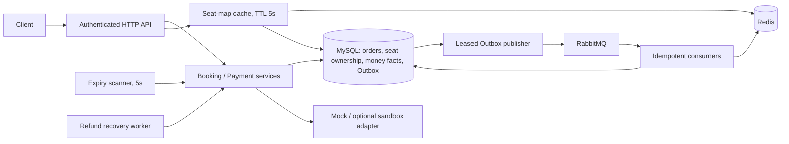

# Architecture and consistency boundaries

The session-seat snapshot is inventory. There is no independent quantity counter
to decrement a second time. EXPLICIT accepts dispersed physical seats; ADJACENT
requires continuous physical positions within one row, block and price zone.
Displayed seat numbers alone cannot establish adjacency.

Create uses one transaction for the idempotency header, amount snapshot, all items,
conditional AVAILABLE→HELD changes and Outbox. A partial conditional update rolls
back the whole attempt. A unique `(user_id,request_id)` plus normalized payload
digest distinguishes replay from conflicting reuse. ADJACENT tries at most three
independent transactions; EXPLICIT never substitutes a different seat.

All changes to existing orders first lock the order row, then seats in stable
physical-ID order. Release predicates require the expected state and original
owner. A cancelled historical order can legitimately reference a seat now held
by someone else. A replay must preserve that new owner.

Clock is injectable; UTC DATETIME(6) is the database convention. Payment must be
processed strictly before expireAt, regardless of whether expiry scanning has run.
Late/duplicate collections remain money facts with durable compensation tasks.
External gateway success is independently committed; its lifetime must exceed a
failed local transaction. NORMAL refund success releases only its own SOLD seats;
compensation refunds do not re-open old inventory.

Redis may be stale or absent and cannot authorize a hold. Outbox and consumer
deduplication provide retryable delivery, not exactly-once transport. Publisher
leases are 30 seconds; automatic retry is bounded at ten attempts with exponential
backoff capped at 60 seconds. Expiry scanning remains a database recovery path
when broker hints are absent. Failed records remain inspectable.

This is a single-service demonstration of transactional boundaries. Replicated
databases, failover, production load capacity and real payment settlement have not
been established by these tests.
